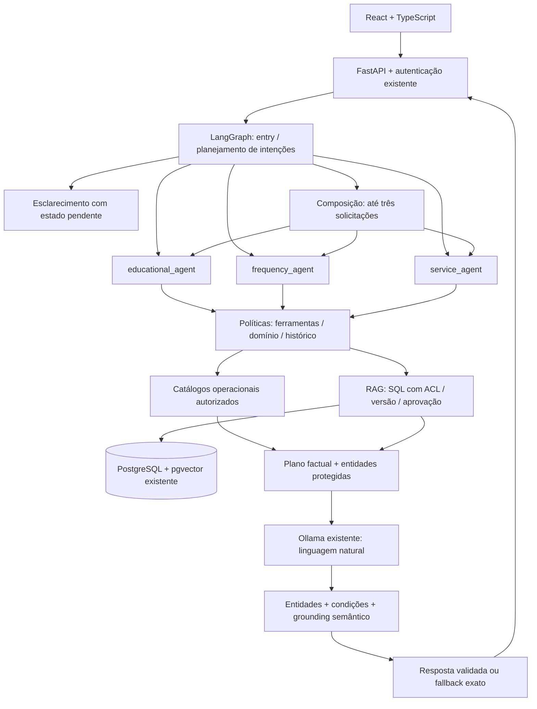

# MilioAI — arquitetura multiagente institucional

Implementação incremental em 22/10/2026. Código preparado e validado em cópia temporária e PostgreSQL isolado; publicação local permanece manual. O banco principal foi inspecionado na revisão `0004`, com 1.136 mensagens, e permaneceu assim após a homologação. Nenhum serviço foi reiniciado, nenhum PDF foi editado e nenhuma reindexação foi executada.

## Arquitetura implementada



Os três nós especialistas compartilham infraestrutura e etapas de recuperação, geração e validação. O registro de políticas escolhe identidade, domínio, tópicos e ferramentas. Não foram criados outros servidores, modelos ou aplicações. Solicitações compostas executam especialistas separadamente; só as respostas concluídas são consolidadas, com referências remapeadas para evitar colisões de F1.

## Responsabilidades e fontes

| Especialista | Responsabilidade | RAG autorizado | Fonte disponível / lacuna |
|---|---|---|---|
| Educacional | Curso, justificativas no curso, instrutores, documentos escolares, desconto por ausência no curso | `education` | Configuração operacional, contatos e diretório de 16 instrutores existentes. Nenhum documento indexado nesse domínio. Endereços e procedimento de contestação ausentes. |
| Frequência | Folha Ponto, registro CURSO/FALTA, ausência e documentos do trabalho | `rh_frequency` | Dois registros PDF de Folha Ponto em `folha-ponto-local-v1`, ambos `local_review` e `validation_only`. `frequency-test.md` é material fictício no escopo `test`. Não há documentos específicos inventariados sobre óbito, gravidez ou afastamentos. |
| Atendimento | VT, VA, VR, convênios, benefícios e segunda via | `benefits`; segunda via: `beneficios.vale_transporte.segunda_via` | PDF de segunda via em `vt-segunda-via-local-v1`, `local_review`, 33 linhas de cartões. Ausentes documentos gerais de VA/VR, convênios, academia e elegibilidade. |

O inventário real, com nomes, versões, escopos e status, está em `environment.json`. Foram copiadas para validação apenas quatro fontes e 53 chunks já indexados, sem gerar embeddings novamente. A ausência de corpus Educacional não autoriza reutilizar documentos de RH: orientações configuradas continuam disponíveis somente quando autorizadas, e respostas documentais sem fonte fazem esclarecimento ou fallback.

`backend/app/support/departments.json` registra responsabilidades, assuntos, contatos, fontes, regras, condições, exceções, aprovação, versão, proveniência e lacunas. Esse catálogo não homologa políticas ou documentos.

## Contatos

| Setor | Telefone fornecido | E-mail | WhatsApp | Validação institucional |
|---|---|---|---|---|
| Educacional | +55 11 99803-0631 | educacional.sp@renapsi.org.br | `https://wa.me/5511998030631`, canal informado pelo responsável | Pendente; restrito a desenvolvimento e `education:contacts` |
| Frequência | +55 11 97080-6028 | frequencia.sp@renapsi.org.br | `https://wa.me/5511970806028`, canal informado pelo responsável | Pendente; exige `local_review` e fonte recuperada vinculada por hash/versão |
| Atendimento | +55 61 8606-0081 | atendimento.sp@renapsi.org.br | Desabilitado; URL nula; pendente de confirmação | Pendente; desenvolvimento e `local_review` |

O telefone de Atendimento conserva exatamente os dígitos fornecidos. Não foi acrescentado 9 nem alterado DDD. Não há confirmação técnica de WhatsApp desse número. O e-mail de Frequência recebeu correção operacional com proveniência própria; o PDF e sua anotação literal permanecem intactos. A resposta atual omite o endereço antigo do trecho projetado, e o cartão estruturado apresenta o endereço corrigido. Mensagens históricas não foram alteradas.

O frontend existente exibe telefone e e-mail de Atendimento sem link WhatsApp, com aviso de confirmação pendente. Links de operadoras continuam vinculados ao procedimento e não são apresentados como contato departamental. Nenhum link inclui mensagem automática ou dados pessoais.

## Roteamento e continuidade

As regras procedurais têm prioridade: registro na Folha Ponto permanece com Frequência mesmo contendo “curso”; justificativa do curso e desconto por falta no curso pertencem ao Educacional; desconto de VT e demais benefícios pertencem ao Atendimento. A prevenção documental de desconto duplicado no registro da folha conserva o caminho de Frequência/FP-07.

Atestado sem curso/trabalho e desconto sem origem provocam esclarecimento. `pending_clarification` guarda a solicitação para resolver respostas curtas como “curso”. Curso + justificativa + preenchimento é decomposto em duas solicitações. O classificador Ollama restrito existente continua tratando serviços operacionais, com barreiras que impedem redirecionamento para ferramentas de outro especialista.

O histórico global permanece armazenado. Cada especialista recebe apenas turnos atribuídos a seus tópicos; mensagens sem atribuição segura e composições são excluídas de seu contexto. URLs não são interpretadas como separadores de solicitações. `active_agent`, `active_domain`, `agent_states` e os campos legados de instrutor/cartão preservam o estado privado por especialista. A troca de domínio guarda e retira seleções do domínio anterior, inclusive em conversas anteriores à nova arquitetura.

## Isolamento, RAG e versões

A autorização de domínio e ferramenta ocorre antes de embeddings e SQL. A consulta materializada preserva escopos autenticados, aprovação, status `approved`, versão elegível, modelo, dimensões e perfil de embedding. Especialistas só aceitam PDF, texto e Markdown como tipos documentais suportados. Fontes com contatos departamentais de outro setor são excluídas no SQL e novamente antes da montagem do contexto. O resolvedor de contatos verifica o proprietário do registro independentemente do tópico solicitado.

Fora de desenvolvimento, tanto `validation_only` quanto o escopo `local_review` são bloqueados. A condição de escopo também protege fontes que tenham um flag documental configurado incorretamente. O teste de integração novo executa o SQL real e verifica domínio, contato estrangeiro, status pendente, versão antiga, escopo privado e revisão local.

`ACTIVE_KB_VERSION` continua regendo Frequência; `EDUCATION_KB_VERSION` e `BENEFITS_KB_VERSION` permitem versões próprias, herdando a versão base quando vazios. VT mantém `VT_KB_VERSION` e a seleção exata por código, sem substituição por busca genérica. O ingest existente ganhou `--domain education|rh_frequency|benefits`; uma fonte já cadastrada em outro domínio não é reclassificada silenciosamente. Não é necessário reindexar o corpus atual para aplicar esta implementação.

## Planejamento factual, linguagem e grounding

Antes, `support/operational.py`/grafo produziam diretamente as orientações Conecta Jovem e os fluxos de instrutor; VT projetava os campos exatos da linha; regras documentais sensíveis usavam seleção e projeção literal. Agora os serviços operacionais e os encaminhamentos autorizados passam por geração real. A tentativa de reformulação de VT mantém todos os blocos e avisos protegidos; sua recuperação exata continua sendo a autoridade factual.

Cada especialista recebe prompt próprio sobre identidade, tom, limites, fontes e ferramentas, somado ao contrato de grounding existente. A camada linguística recebe somente o plano autorizado, histórico filtrado e marcadores opacos de contatos e destinos. O backend restaura URLs, telefones e e-mails; o modelo não precisa transcrevê-los. A referência ao plano operacional único é atribuída pelo backend, depois passa por validação de entidades, regras/condições e sustentação semântica. Referências documentais do RAG continuam ligadas às fontes originais.

`RESPONSE_TEMPERATURE=0.25` e `RESPONSE_TOP_P=0.9` afetam somente a linguagem. Classificação, seleção de campos/regras e verificação continuam com temperatura zero. O modelo e o limite de tokens existentes são reaproveitados. Nenhum texto gerado é emitido no streaming antes da validação.

Continuam determinísticos: permissões, domínios, campos exatos, ações e seleção de instrutor, contatos/links, esclarecimentos seguros, fallback e regras de alto risco de Folha Ponto. Condições e avisos operacionais relevantes são protegidos como trechos íntegros. A geração não aprova documentos, benefícios, direitos ou políticas. Falha de grounding preserva a resposta factual segura.

## Testes e evidências

- Linha de base: 147 testes direcionados antes da integração.
- Regressão com mocks e PostgreSQL isolado: 212 aprovados, 29 testes live excluídos, 21,45 s (`final-checks.json`).
- Suíte específica posterior, incluindo execução Educacional + Frequência na mesma pergunta: 33 aprovados em 0,23 s (`supplemental-checks.json`). Há sobreposição entre suítes; os números não devem ser somados.
- Frontend: 44 testes aprovados, build de produção e ESLint de `src` aprovados. O lint global aponta `console` não definido em um arquivo anterior de auditoria (`docs/rag-quality/audits/2026-10-21/.work/build_csv.mjs:40`), preservado.
- Ruff: todos os arquivos de implementação e novos scripts/testes verificados passaram.
- Migração real em banco separado: `0004 → 0005`, conteúdo pré-existente preservado, novo `contacts=[]`. Banco principal manteve revisão `0004` e 1.136 mensagens (`environment.json`).
- Ollama real `qwen3:4b-instruct` e PostgreSQL: 12/12 rotas corretas. Última consolidação: 6 respostas contextuais validadas, 4 fallbacks seguros e 2 respostas determinísticas. Respostas sem documentação de benefícios mantêm `outcome=no_evidence` mesmo oferecendo encaminhamento autorizado; não foram convertidas em cobertura suficiente.
- A bateria histórica de 76 casos não foi reexecutada. Contratos e métricas anteriores permanecem intactos; `historical-sha256.json` registra seus hashes. FP-07/FP-13 e testes adversariais fizeram parte da regressão com mocks, sem bateria repetitiva de inferência real.

| Cenário | Turno | Agente | Modo entregue | Latência ms |
|---|---|---|---|---|
| benefit_discount | 1 | service_agent | safe_fallback | 6133 |
| benefit_discount | 2 | service_agent | contextual | 5227 |
| course_certificate | 1 | educational_agent | contextual | 3356 |
| course_certificate | 2 | educational_agent | contextual | 2913 |
| generate_timesheet | 1 | frequency_agent | contextual | 2287 |
| generate_timesheet | 2 | frequency_agent | contextual | 1584 |
| instructor | 1 | educational_agent | deterministic | 636 |
| instructor | 2 | educational_agent | deterministic | 4 |
| sptrans | 1 | service_agent | safe_fallback | 8125 |
| sptrans | 2 | service_agent | safe_fallback | 5674 |
| work_certificate | 1 | frequency_agent | safe_fallback | 1161 |
| work_certificate | 2 | frequency_agent | contextual | 1493 |

A consolidação `live-final.json` identifica a origem dos resultados: quatro pares de fluxos gerativos após os ajustes finais e os dois pares anteriores preservados de SPTrans/instrutor. `live.json`, `live-before-markers.json` e `installed-baseline.json` guardam medições anteriores, sem substituir histórico da Sprint 2.

Exemplos reais: no retorno sobre atestado do trabalho, “Você pode enviar o atestado de falta pelo [Conecta Jovem]”, com o destino completo restaurado pelo backend. No encaminhamento de VT, a resposta identifica Atendimento, conserva `+55 61 8606-0081` e `atendimento.sp@renapsi.org.br`, informa ausência de procedimento documentado e mantém WhatsApp pendente. As respostas completas e fontes estão nos JSONs.

A pergunta repetida sobre onde gerar Folha Ponto manteve a mesma formulação nas duas gerações reais. Isso é resultado diagnóstico, não prova de ausência de geração: o pipeline chamou o Ollama e validou o conteúdo. O contexto alterou o fluxo do curso, evitando repetir a pergunta de instrutor já feita. Não houve obrigação artificial de diversidade nem sorteio de templates.

Latência final observada: média 3.216 ms, intervalo 4–8.125 ms para esses 12 atendimentos. A medição anterior da aplicação instalada teve média 905 ms; a diferença aproximada de 2.311 ms inclui geração, validação e diferenças de fluxo, sem constituir experimento controlado. SPTrans ainda caiu no fallback literal nos dois testes: a geração não conseguiu conservar integralmente todos os blocos protegidos. Melhorias de desempenho e aprofundamento da diversidade continuam fora desta entrega/Sprint 3.

## Arquivos desta evolução

Novos: `backend/app/agents/policies.py`; `backend/app/support/{routing.py,generation.py,departments.json}`; `backend/tests/{test_multiagent.py,test_multiagent_isolation_integration.py}`; `backend/scripts/{evaluate_multiagent.py,validate_multiagent_environment.py,run_multiagent_final_checks.py,diagnose_linguistic_generation.py}`; esta pasta de documentação/evidências.

Evoluídos: `backend/app/orchestration/graph.py`; `backend/app/rag/{retrieval.py,ingest.py}`; `backend/app/support/{contacts.py,institutional_contacts.json,context.py,intents.py,catalog.py}`; `backend/app/core/config.py`; somente os parâmetros de linguagem em `backend/app/llm/ollama.py`; `.env.example`; `src/{types.ts,components/InstitutionalContacts.tsx,components/InstitutionalContacts.test.tsx}`; expectativas de contrato e mocks em testes existentes de unidade, catálogo, integração, operação, orquestração e confiabilidade institucional.

Os arquivos de contatos, grounding, exatidão, conhecimento institucional, contratos v3 e migração `0005` já eram trabalho não commitado recebido. Foram reaproveitados, sem substituição do projeto. O estado inicial, patch e cópias dos arquivos novos recebidos estão em `tmp/multiagent/`; as cópias terminam em `.snapshot` para não entrarem na descoberta automática de testes. Nenhum commit, reset ou descarte foi executado.

## Publicação local: ordem manual segura

A `0005_institutional_contacts.py` depende de `0004` e acrescenta apenas `messages.contacts JSONB NOT NULL DEFAULT []`. Não foi criada outra migração e não foi aplicado downgrade. Os comandos abaixo são instruções; não foram executados no ambiente principal.

No diretório raiz da aplicação, em PowerShell:

```powershell
# 1. Gerar backup em formato binário sem redirecionamento textual do PowerShell.
docker compose exec -T db sh -c 'pg_dump -U "$POSTGRES_USER" -d "$POSTGRES_DB" -Fc -f /tmp/milioai-before-0005.dump'
$dbContainer = docker compose ps -q db
docker cp "${dbContainer}:/tmp/milioai-before-0005.dump" ./milioai-before-0005.dump
# Conferir o arquivo e sua restauração em banco separado antes de prosseguir.

# 2. Revisar diff/configuração e construir a imagem nova; ainda sem reiniciar serviços.
git diff --check
docker compose build api

# 3. Verificar a revisão usando a imagem nova e aplicar somente a migração revisada.
docker compose run --rm --no-deps api python -m alembic current
docker compose run --rm --no-deps api python -m alembic upgrade 0005
docker compose run --rm --no-deps api python -m alembic current

# 4. Publicar a API após confirmar 0005; o serviço db permanece ativo.
docker compose up -d --no-deps api

# 5. Verificar o frontend e publicar dist no mecanismo local já usado.
npm test
npm run build
```

A pausa/recriação da API no passo 4 é uma ação manual de publicação. Se houver problema, retornar à imagem anterior mantendo a coluna aditiva; não apagar mensagens nem executar downgrade para desfazer o deploy. Nenhum segredo deve ser alterado ou incorporado ao código. `.env.example` documenta apenas os novos parâmetros opcionais.

Para reproduzir a homologação, execute no backend com credenciais administrativas locais apropriadas `python scripts/validate_multiagent_environment.py --tests --live`. Esse script cria um banco com prefixo `milioai_multiagent_`, aplica migrações apenas nele, copia o corpus e deixa o banco de evidência disponível. Não execute testes de integração apontando para o banco principal. Os bancos isolados criados nesta tarefa foram mantidos, sem limpeza destrutiva automática.

## Pendências para encerrar tecnicamente a Sprint 2

1. Aprovar institucionalmente contatos, regras e canais operacionais; confirmar tecnicamente o WhatsApp de Atendimento antes de habilitá-lo.
2. Fornecer e classificar documentos Educacionais, endereços/unidades, procedimento de contestação e documentos específicos de frequência/benefícios ausentes. Publicar somente versões aprovadas e com escopos apropriados.
3. Aplicar manualmente a `0005` e publicar a imagem/frontend conforme a ordem acima.
4. Executar uma única bateria final de 76 casos quando corpus, contratos e critérios de homologação estiverem aprovados. Preservar inconclusivos e resultados anteriores.
5. Revisar o resultado conservador de SPTrans e a naturalidade das respostas repetidas com hipóteses e amostras delimitadas; não retirar proteções para aumentar diversidade.

A implementação está preparada para revisão e publicação local. A homologação institucional e o encerramento global da Sprint 2 permanecem pendentes desses insumos e da validação final correspondente.
